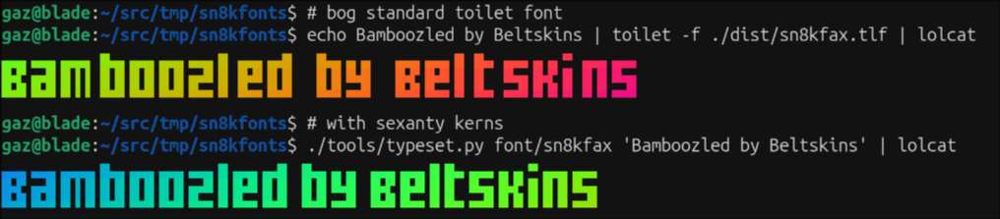

# sn8kfonts

Blocky FIGlet/TOIlet fonts drawn as plain-text grids, built at subpixel
resolution; half-blocks (1×2 per cell), Unicode sextants (2×3 per cell,
U+1FB00 Symbols for Legacy Computing), and Unicode 16 octants (2×4 per cell).

Made for TeleText fonts in my game, [sn8ks](https://sn8ks.bitplane.net).

These `.tlf` releases work in any standard figlet engine. They carry a small
extra promise: every glyph cell decodes back to its subpixel bitmap, so a
block-aware engine can recover the true letterforms and kern them at
subpixel resolution. A `kern:` comment line in each font's header declares the
intended mode (`auto` = per-row subpixel kerning, `fixed` = advance by glyph
width, which is exactly what a standard engine does anyway).

The difference is this:



## Fonts

- **sn8kfax** — a tribute to the hand-pixelled headline lettering of CEEFAX:
  the mosaic letterforms teletext page artists built from 2×3 graphics
  blocks, one cell at a time. Sextant encoding, subpixel kerning.
- **sn8kblock** — the sn8ks title font. Half-block encoding, fixed advance.
- **sn8k5050** — the Mullard SAA5050/Mode 7 character ROM reduced from its
  authentic 5×10 bitmap to an editable 4×8 grid and encoded as two-by-two
  Unicode 16 octants. Fixed two-column advance for double-height teletext.

Each has a plain-text `.quadrant` variant (`font/<name>.quadrant/`, built
with the `text` encoding) for terminals with nothing finer than quadrants;
sn8ks switches to it by itself at that tier and below. `sn8k5050.quadrant`
is each letter above a blank row, by script.
`sn8kfax.quadrant` is FIGlet's Mini by Glenn Chappell, top three rows, imported
with `tools/flfimport.py`; its `CREDITS` file carries Mini's attribution into
the built font, as Mini's licence asks.

## Format

One glyph per `.txt` file: space or `.` = empty, anything else = ink.
Rows pad to the widest row, then to the encoding's cell size. Vertical
placement matters — keep empty rows explicit with dots so nothing trims
them.

Filenames are `NNNN_mnemonic.txt` — 4-6 hex digits of the codepoint, then a
label the tools ignore: `0061_a.txt`, `0041_A.txt`, `003F_question.txt`.
The hex is what makes the repo portable: bare `a.txt`/`A.txt` pairs collide
on case-insensitive filesystems (Windows, default macOS) and `? : / < > * \`
can't be filenames on Windows at all. Bare single-character names (`8.txt`)
still parse, for scratch work on a case-sensitive box.

## Loop

```sh
tools/watch.sh font/sn8kfax          # live-render everything while you edit
python3 tools/render.py font/sn8kblock --encoding halfblock
python3 tools/render.py font/sn8k5050 --encoding octant
python3 tools/typeset.py font/sn8kfax "NEWS"   # subpixel typesetting
make                                 # build every font into dist/*.tlf
figlet -d dist -f sn8kfax "NEWS"
```

`tools/saa5050import.py` bootstraps `font/sn8k5050` from the preserved ROM
rows. It never overwrites hand edits unless passed `--force`. Consumers that
want to embed the edited 4×8 bitmaps can generate a reviewable Rust table:

```sh
python3 tools/exportrows.py font/sn8k5050 -o sn8k5050.rs
```

For the sibling `ttx42` checkout, the complete tweak loop is:

```sh
$EDITOR font/sn8k5050/0030_0.txt
python3 tools/render.py font/sn8k5050/0030_0.txt --encoding octant
make
python3 tools/exportrows.py font/sn8k5050 -o ../ttx42/src/sn8k5050.rs
cargo fmt --manifest-path ../ttx42/Cargo.toml
```

`typeset.py` is the reference renderer: it composes glyph bitmaps at
subpixel resolution with per-row auto-kerning, then encodes to blocks —
letters can sit at odd half-cell offsets, which cell-level composition
can't do (FIGlet layout quantizes spacing to whole cells in one fixed
phase). The `.tlf` bakes a `--gap` of empty subpixel columns into each
glyph so standard engines space the font sensibly; block-aware engines
ignore the padding and kern from the decoded ink.

Per-font export flags live in the `Makefile`. Releases are tagged: CI runs
`make` and attaches `dist/*.tlf`.

Your terminal needs sextant support for sn8kfax (vte/gnome-terminal, kitty,
WezTerm, ghostty, recent alacritty all synthesize them; no special font
needed). `sn8k5050` additionally requires Unicode 16 octant support.
sn8kblock is plain half-blocks and renders anywhere.

## License

You were going to what you wanted anyway, right? So it's WTFPL. Except
`sn8kfax.quadrant` and `source/mini.flf`, which are FIGlet's (BSD-3-Clause; see
`THIRD_PARTY_LICENSES.md`).
